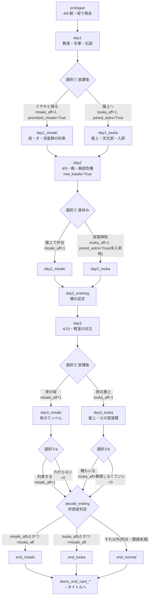

# 星見坂のセレナーデ ルートフロー・分岐仕様

> 状態マーク: **[確定]** = 現状の `story/*.rpy` に実装済み。 **[提案]** = 製品版設計案（未レビュー。`story-bible.md` の [未決] と連動）。

## 1. 体験版の現状フロー [確定]



### 1.1 変数と配点 [確定]

| 変数 | 型 | 初期値 | 上昇条件 |
|---|---|---|---|
| `misaki_aff` | int | 0 | ①(坂で帰る)+1、②(弁当)+1、③(夜の坂)+1、④a(約束する)+1。最大4 |
| `touka_aff` | int | 0 | ①(屋上)+1、②(掃除)+1、③(夜の屋上)+1、④b(俺もいる)+1。最大4 |
| `joined_astro` | bool | False | ①(屋上) または ②(掃除) で True |
| `promised_misaki` | bool | False | ①(ミサキと帰る) で True |
| `met_kaede` | bool | False | day2 進入で True |

### 1.2 ルート判定（`decide_ending`）[確定]

```python
if misaki_aff >= 3 and misaki_aff > touka_aff:   end_misaki
elif touka_aff >= 3 and touka_aff > misaki_aff:  end_touka
else:                                            end_normal
```

- 到達例: ①②③④a を全てミサキ側 → (4,0) で end_misaki。④a を外すと (3,0) でstill end_misaki（④は「決定的な一言」だが END 可否には直結しない設計）
- 混在例: ①ミサキ・②冬華・③ミサキ・④a約束 → (3,1) end_misaki。同数 (2,2) 等は end_normal

### 1.3 到達不能パターン [確定]（テストで検証済み: testcases.rpy）

- ミサキ END に `promised_misaki` は不要（①で冬華を選んでも ②③④a で 3 点作れる）→ [提案] 製品版ではルート進入条件に flag を要求（下記 §2）
- 同一プレイで2ヒロインEND同時到達は不可（判定が単一）

## 2. 製品版ルート構成 [提案]

共通ルート（全プレイ共通）→ 個別ルート（ミサキ／冬華）→ 最終章（TRUE END のみ）の3層構成。

```
共通ルート（day1〜day3+day4 をday5まで拡張案）
 ├─ ミサキルート進入 → 個別章M(3話+BAD/GOOD) → 夏章M
 ├─ 冬華ルート進入   → 個別章T(3話+BAD/GOOD) → 夏章T
 ├─ 条件未達 → ノーマルEND(拡大版)
 └─ TRUE END: 両 GOOD END  viewing + 最終章条件(§3)
```

### 2.1 ルート進入条件 [提案]

| ルート | 条件案 | 根拠フラグ |
|---|---|---|
| ミサキ | `misaki_aff >= 4` かつ `promised_misaki` ①でミサキ経路が実質必須に | 約束 flag を必須化（story-bible §6） |
| 冬華 | `touka_aff >= 4` かつ `joined_astro` | 天文部存続が冬華ルートの土台 |
| ノーマル | 上記いずれも満たさない | 既存 decide_ending を拡張し、day5 終盤で判定 |

- 配点再設計: **[決定案A・承認待ち]** day1〜3 の 4 択を維持 + day4(4/11) に新選択⑤を追加し**最大5**。進入閾値 4（flag 必須）。最終章前の確約は flag のみで aff を増やさない。詳細は story-bible.md §7 表 / §8-5

### 2.2 個別ルート内の分岐 [提案]

各個別章に 2 箇所の中核選択肢（決断系）。

```
個別章M: M-core-1(七年前の約束の真相 §story-bible 未決3)
          M-core-2(流星群の夜の前日、ミサキと向き合う覚悟)
          GOOD: M-core-2 正解 →「約束の答え」→ GOOD END
          BAD : 誤答/回避 →「七年目のすれ違い」BAD END
個別章T: T-core-1(父の望遠鏡と遺志)
          T-core-2(観測を続ける理由＝自分の気持ちの承認)
          GOOD: T-core-2 正解 →「二人の観測」→ GOOD END
          BAD : 誤答/回避 →「冬の星座の別れ」BAD END
```

- BAD END は `end_bad_misaki` / `end_bad_touka` として `persistent.endings_seen.add("bad_misaki")…` に記録 [提案]（有無・本数は story-bible 未決6 と連動）

### 2.3 エンディング一覧（製品版想定）[提案]

| ID | 名称 | 種別 | 解放条件 |
|---|---|---|---|
| `end_misaki_good` | ミサキ GOOD END | GOOD | ミサキルート M-core-2 正解 |
| `end_misaki_bad` | 七年目のすれ違い | BAD | ミサキルート M-core-2 誤答 |
| `end_touka_good` | 二人の観測 | GOOD | 冬華ルート T-core-2 正解 |
| `end_touka_bad` | 冬の星座の別れ | BAD | 冬華ルート T-core-2 誤答 |
| `end_normal` | みんなで見上げる星空 | NORMAL | ルート未進入 |
| `end_true` | 星見坂のセレナーデ（TRUE） | TRUE | §3 条件 |

## 3. TRUE END 進入条件 [提案]

issue #28 の指示（条件をコードへ直書きせず route-flow.md へ明記 + テストケース作成）に従う。

```python
# 最終章 day5 終幕で判定（decide_ending とは別: decide_true_route）
persistent.endings_seen ⊇ {"misaki", "touka"}   # 両 GOOD END を視聴済み（current 体験版名。製品版では *_good に読替）
and (misaki_aff + touka_aff) の共通ルート配分が「どちらかに偏りすぎない」? → ✗ 却下案
→ 採用案: TRUE END は「3人目の物語」ではなく、両ヒロインの GOOD END を踏んだ主人公が
  流星群の夜(8/12)に「もう一つの約束」を果たす最終章専用シナリオ。
  「もう一つの約束」[決定案A・承認待ち] = 1966年の流星群の夜、冬華の父（当時7歳）が丘で交わし
  果たせなかった30年約束。1996/8/12 に主人公世代がリレー完走することで、
  「星降りの伝説」の発生源と作品テーマ（何年もかけて届く光）を回収する（story-bible §8-4）。
条件: 両 GOOD 視聴(persistent) + 最終章で新規フラグ star_promise=True（day5 の新選択肢で獲得）
```

- [提案] 詳細: 最終章は day2_evening の楓の証言に対応する「丘の伝承の本当の由来」を開く章。TRUE END にはどちらの個別ルートからも day5 で分岐して入るが、**両 GOOD 視聴済みでないと view できない**（おまけの END リストではなく本編解放。`persistent.endings_seen` を game 変数 `seen_good_both` で写し、脚本で参照）
- 理由: 体験版からの周回動機（#28「不合理な隠し条件にしない」）→ END リスト画面（おまけ）で TRUE のヒント文言を表示 [提案]
- 到達不能検査: 両 GOOD 視聴なしで day5 分岐選択 → 通常章へ収束（TRUE は開かない）。テスト T-TRUE-1

### 3.1 TRUE END 条件テスト（#43 に接続） [提案]

| ケース | 手順 | 期待 |
|---|---|---|
| T-TRUE-1 | endings_seen={misaki,touka} で day5 → star_promise 選択 | end_true 到達 |
| T-TRUE-2 | endings_seen={misaki} のみで day5 | end_true 非到達・通常 END |
| T-TRUE-3 | 全 GOOD/BAD/NORMAL の到達網羅（testcase 1本ずつ） | 全 EN 解放 |
| T-TRUE-4 | day5 中間セーブ→ロード→選択継続 | aff/flag 復元 |

## 4. 体験版→製品版の移行メモ [提案]

- 現行 `end_misaki/end_touka/end_normal` は製品版では**共通ルート終盤の「予感END」ではなく本編へ置換**。ラベルは互換のため温存し `config.label_overrides` で差し替え可（demo-design §5.1）
- `promised_misaki`・`joined_astro` は製品版ルート条件で必須化 → day1 の ①が単なる aff 配点でなくなる。説得シーン加筆は #25 台本で
- 新規必要アセット（背景: 夏・丘の夜・祭、CG: 個別 GOOD/BAD・TRUE、BGM: 流星群テーマ等）は #20/#34/#35/#56 の残余としてアセット Issue 側で管理

## 5. 決定待ち → **決定案A 起草済み**（2026-11-08、承認待ち）

各項目の決定案と設計根拠は **story-bible.md §7（承認チェック表）/ §8** に集約済み。要約:

| 項目 | 決定案A |
|---|---|
| aff 配点・閾値 | 最大5（day4 に新⑤追加）/ 進入閾値 4 + flag（§8-5） |
| BAD END 本数 | 2（各ルート1・新規CGなし）（§8-3） |
| TRUE END の「もう一つの約束」 | 1966年の丘の約束（冬華の父世代）のリレー完走。伝承の発生源と合体（§8-4） |
| day5 時間構成 | day4=4/11 1本 + 「5月/7月」圧縮テロップ + 最終章=8/11〜13（§8-6） |
