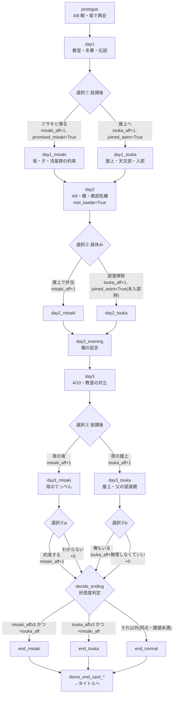

# 星見坂のセレナーデ ルートフロー・分岐仕様

> 状態マーク: **[確定]** = 現状の `story/*.rpy` に実装済み。 **[提案]** = 製品版設計案（未レビュー。`story-bible.md` の [未決] と連動）。

## 1. 体験版の現状フロー [確定]



### 1.1 変数と配点 [確定]

| 変数 | 型 | 初期値 | 上昇条件 |
|---|---|---|---|
| `misaki_aff` | int | 0 | ①(坂で帰る)+1、②(弁当)+1、③(夜の坂)+1、④a(約束する)+1。最大4 |
| `touka_aff` | int | 0 | ①(屋上)+1、②(掃除)+1、③(夜の屋上)+1、④b(俺もいる)+1。最大4 |
| `joined_astro` | bool | False | ①(屋上) または ②(掃除) で True |
| `promised_misaki` | bool | False | ①(ミサキと帰る) で True |
| `met_kaede` | bool | False | day2 進入で True |

### 1.2 ルート判定（`decide_ending`）[確定]

```python
if misaki_aff >= 3 and misaki_aff > touka_aff:   end_misaki
elif touka_aff >= 3 and touka_aff > misaki_aff:  end_touka
else:                                            end_normal
```

- 到達例: ①②③④a を全てミサキ側 → (4,0) で end_misaki。④a を外すと (3,0) でstill end_misaki（④は「決定的な一言」だが END 可否には直結しない設計）
- 混在例: ①ミサキ・②冬華・③ミサキ・④a約束 → (3,1) end_misaki。同数 (2,2) 等は end_normal

### 1.3 到達不能パターン [確定]（テストで検証済み: testcases.rpy）

- ミサキ END に `promised_misaki` は不要（①で冬華を選んでも ②③④a で 3 点作れる）→ 製品版ではルート進入条件に flag を要求（**#25 実装済み**: 選択⑥の条件ゲート、§1.4）
- 同一プレイで2ヒロインEND同時到達は不可（判定が単一）

### 1.4 製品版共通ルート拡張（#25 実装済み・2026-11-09）

day3 終盤は `decide_ending` ではなく **day4 へ接続**（`decide_ending` ラベルは互換温存・本編未参照）。

```mermaid
flowchart TD
    C4M -- 約束する(④a +1) --> D4
    C4T -- 俺もいる(④b +1) --> D4
    D4[day4 4/11<br/>和解・坂で記憶のかけら<br/>if: 優先ヒロイン別の対話] --> C5{"選択⑤ 週末(4/13) 3択"}
    C5 -- 丘をミサキと下見<br/>M+1, weekend_plan=misaki, hill_memory --> D5
    C5 -- 冬華と望遠鏡整備<br/>T+1, weekend_plan=touka, fathernote --> D5
    C5 -- 家にこもる<br/>weekend_plan=none, hill_memory --> D5
    D5[day5 4/15→8/11 圧縮<br/>5月:部員3人/6月:審査通過<br/>7月:カウントダウン/8/11:3つの影] --> C6{"選択⑥ 8/12の夜<br/>(条件表示ゲート)"}
    C6 -- "ミサキ（流星群の夜へ）<br/>if promised_misaki ∧ aff>=4" --> RM[route_misaki<br/>#26 実装済み: misaki_m1→m2(M-core-1)→m3(M-core-2)<br/>→ GOOD/BAD END]
    C6 -- "冬華（屋上の観測夜へ）<br/>if joined_astro ∧ aff>=4" --> RT[route_touka<br/>#27 実装済み: touka_t1→t2(T-core-1)→t3(T-core-2)<br/>→ GOOD/BAD END]
    C6 -- "この街へ（常時表示）" --> EN[end_normal 拡大<br/>8/12全員観測・NORMAL]
```

**章一覧と素材指定（#25）**

| label | 日 | 内容 | bg | BGM/SE | 選択肢 |
|---|---|---|---|---|---|
| `day4` | 4/11 | 和解の兆し・新聞部の観測申請情報・坂で記憶の断片（if で対話変化） | hallway / classroom / slope_sunset | day, evening / chime | ⑤（3択） |
| `day4_scout_misaki` | 4/13 | 丘の下見。1989年の約束の片鱗（hill_memory） | slope | misaki | — |
| `day4_teach_touka` | 4/13 | 父の1966年観測ノートと欄外「丘にて、彼女と。三十年後、必ず」（fathernote） | clubroom | touka / page | — |
| `day4_homealone` | 4/13 | 子どもらしい筆跡の「7年後の約束」発見、夜の坂でミサキと合流（hill_memory） | home / slope_night | day, evening | — |
| `day5` | 4/15→8/11 | 圧縮ブリッジ（date_card テロップ）: 5月=部員3人（joined_astro で対話分岐）/6月=審査通過/7月=カウントダウン（if で対話分岐）/8/11=3つの影 | classroom / clubroom / hallway / slope_sunset | day, touka, evening | ⑥（条件表示） |
| `route_misaki`→`misaki_m1` | 8/11 | **実装済み(#26)** M-1 前夜: てっぺんでの決意と別れ→家の夜（hill_memory 変種。30年後の約束の予感） | slope_sunset / home | evening→misaki / heart | — |
| `misaki_m2` | 8/12 | M-2 丘: 鳥居合流→平たい石。ミサキのメモ（1989原文）。自分のメモとの二枚一組の真相は hill_memory 変種。**M-core-1**: 覚えていないと認める/ふりする | slope | misaki→tension(嘘分岐) / page | ⑦（2択→`misaki_honest`） |
| `misaki_m3` | 8/12夜 | M-3 丘観測・流星数え。**M-core-2「約束の答え」**: honest/bluff で選択肢文言が分かれる（各2択） | slope_night | misaki / shoot, heart | ⑧（2択→GOOD/BAD） |
| `end_misaki_good` | 8/12 | **MISAKI END『約束の答え』**: CG は予告END cg misaki_end 流用。三十年後の約束（TRUE END §3 の 1966 年リレーと対になる motif） | CG | misaki→title / page, shoot | — |
| `end_bad_misaki` | 8/12 | **BAD END『七年目のすれ違い』**: 新規CGなし・カード演出のみ（決定案A §8-3）。置き去りのメモ | slope_night | — / shoot, wind | — |
| `route_touka`→`touka_t1` | 8/11 | **実装済み(#27)** T-1 前夜: 観測段取り確認→家の夜（fathernote 変種: 1966年ノートの続き） | slope_sunset / home | evening→touka / heart | — |
| `touka_t2` | 8/12 | T-2 天文部: 望遠鏡組立・ノート（未視聴ならここで初開示→fathernote=True 加算）→屋上へ運び出し。**T-core-1**: 「バトンを一緒に」(relay)/「綾瀬さんのための観測は」(self) | clubroom | day→touka / door, page | ⑨（2択→`touka_motive`） |
| `touka_t3` | 8/12夜 | T-3 屋上二人観測（町観測会と独立、1時間早く校門から）。motive 分岐で T-core-2 導入差分。**T-core-2「自分のための星」**: 継走をやめて自分の星空へ/任務完了で幕 | rooftop_night | touka / door, shoot, page | ⑩（2択→GOOD/BAD） |
| `end_touka_good` | 8/12深夜 | **TOUKA END『二人の観測』**: 記録1996-12 共同観測第一号。cg touka_end 流用。欄外「父さん。続きは、二人で書いたわ」（1966年リレー回収・#28 接続） | rooftop_night→CG | touka→title / page, shoot | — |
| `end_bad_touka` | 8/12夜 | **BAD END『冬の星座の別れ』**: 望遠鏡を保管庫へ・名を拭う。新規CGなし | rooftop_night | — / page, door, wind | — |
| `end_normal` | 8/12夜 | **拡大済み**: 町あげての観測夜。fathernote/hill_memory の変種台詞。CG normal_end | slope_night → CG | evening→title / shoot | — |

**新規 game 変数（variables.rpy、セーブ/ロールバック対象）**

| 変数 | 型 | 設定箇所 | 用途 |
|---|---|---|---|
| `weekend_plan` | str | day4 選択⑤ | 4/13 の過ごし方。後続 day5 の 5月 対話分岐に使用 |
| `hill_memory` | bool | ⑤a / ⑤c | 1989年の丘の記憶（決定案A §8-1）に触れた。end_normal 変種、#28 回収 |
| `fathernote` | bool | ⑤b | 父の1966年ノート（決定案A §8-4・TRUE END 布石）。end_normal 変種、#28 star_promise 準備 |
| `misaki_honest` | bool | M-core-1（⑦） | 「覚えていない」と認めたか。M-core-2 の選択肢文言と GOOD/BAD END の变種決定（#26） |
| `touka_motive` | str | T-core-1（⑨） | 冬華の動機答え "relay"(遺志の継走)/"self"(自分のための星)。T-3 の T-core-2 導入と GOOD/BAD END の变種（#27） |

**配点・判定は決定案A のまま実装**: aff 最大5（①〜⑤）、進入閾値 `aff>=4` + flag。⑥はゲート付き choices（条件を満たさない選択肢は表示されない）。`この街へ` は常時表示 → NORMAL 直行。両ルート条件同時成立は選択構造上不可（混在時にどちらかが閾値未満）。

**素材ギャップ（正式差し替え候補 → #20/#35/#56 にリンク）**
- 丘の昼背景（`day4_scout_misaki`/`day5` 8/11 を slope + 台詞描写で代替）
- 父のノート小道具CG/差し替え画像（現状テキスト描写のみ）。ミサキの約束メモ（`misaki_m2`）も同様に描写のみ
- GOOD END CG: 予告END の cg misaki_end 流用（新規正式CGは #56/#20）
- 5月/6月/7月 モンタージュ専用BGM（day/touka/evening 流用）
- 夏服レイヤー（5〜8月も制服立ち絵レイヤーを流用）

**セーブ互換メモ**: day2/day3/variables の編集で行位置が変わるため、dev 期間の旧セーブは壊れうる（0.97 配布ビルドからの継続プレイは非保証）。label 改名は行っていない（demo-design §5.1 遵守）。

## 2. 製品版ルート構成 [提案]

共通ルート（全プレイ共通）→ 個別ルート（ミサキ／冬華）→ 最終章（TRUE END のみ）の3層構成。

```
共通ルート（day1〜day3+day4 をday5まで拡張案）
 ├─ ミサキルート進入 → 個別章M(3話+BAD/GOOD) → 夏章M
 ├─ 冬華ルート進入   → 個別章T(3話+BAD/GOOD) → 夏章T
 ├─ 条件未達 → ノーマルEND(拡大版)
 └─ TRUE END: 両 GOOD END  viewing + 最終章条件(§3)
```

### 2.1 ルート進入条件 [提案]

| ルート | 条件案 | 根拠フラグ |
|---|---|---|
| ミサキ | `misaki_aff >= 4` かつ `promised_misaki`。**実装済み（#25）**: day5 選択⑥の条件表示ゲート。①でミサキ経路が実質必須に | 約束 flag を必須化（story-bible §6） |
| 冬華 | `touka_aff >= 4` かつ `joined_astro`。**実装済み（#25）**: 同ゲート | 天文部存続が冬華ルートの土台 |
| ノーマル | `この街へ` は常時表示。両ゲート未達の収束先。8/12 全員観測夜へ（end_normal 拡大・**実装済み**） | 既存 decide_ending は互換温存・未参照 |

- 配点: day1〜3 の既存4択 + day4(4/11)⑤ で**最大5**、進入閾値 4。**#25 で実装済み**（詳細 §1.4）。最終章前の確約は aff を増やさない想定（#26/#27）

### 2.2 個別ルート内の分岐 ── 章M・章T ともに **実装済み（#26/#27・2026-11-09）**

各個別章に 2 箇所の中核選択肢（決断系）。

```
個別章M [実装済み]: M-core-1(七年前の約束の真相。label misaki_m2 の menu。
          「覚えていない、と正直に認める」→ misaki_honest=True / 嘘→False。
          メモの原文=決定案A §8-1 の 1989年丘の約束そのもの。hill_memory で二枚一組の真相変種)
          M-core-2(8/12夜「約束の答え」。label misaki_m3 の menu。honest/bluff で文言差分・各2択)
          GOOD: M-core-2 正解 → end_misaki_good「約束の答え」(endings_seen: misaki_good)
          BAD : 誤答/回避 → end_bad_misaki「七年目のすれ違い」(endings_seen: bad_misaki)
個別章T [実装済み(#27)]: T-core-1(父のノートと「遺志のバトン」。label touka_t2 の menu。
          relay(二人継走)/self(自分のための星を問う) — 正誤ではなく冬華の動機の軸を決める。
          fathernote 未視聴なら T-2 で初開示し fathernote=True に加算（#28 布石のこぼれ防止）)
          T-core-2(8/12夜 屋上観測後「自分が何者か決める言葉」。label touka_t3 の menu。
          motive で導入文が差分、選択肢は共通2択)
          GOOD: T-core-2 正解 → touka_t3→end_touka_good「二人の観測」(endings_seen: touka_good)
          BAD : 誤答/回避 → end_bad_touka「冬の星座の別れ」(endings_seen: bad_touka)
```

- BAD END は `end_bad_misaki`（実装済み）/ `end_bad_touka`（#27）として `persistent.endings_seen.add(...)` に記録。END リスト（おまけ）にも `ENDING_LIST` 経由で解放表示（misaki_good/bad_misaki エントリ実装済み）

### 2.3 エンディング一覧（ID=persistent.endings_seen のキー）

| ID | 名称 | 種別 | 解放条件 | 状況 |
|---|---|---|---|---|
| `misaki_good` | MISAKI END『約束の答え』 | GOOD | ミサキルート M-core-2 正解 | **実装済み(#26)** |
| `bad_misaki` | 七年目のすれ違い | BAD | ミサキルート M-core-2 誤答/回避 | **実装済み(#26)** |
| `touka_good` | TOUKA END『二人の観測』 | GOOD | 冬華ルート T-core-2 正解 | **実装済み(#27)** |
| `bad_touka` | 冬の星座の別れ | BAD | 冬華ルート T-core-2 誤答/回避 | **実装済み(#27)** |
| `normal` | NORMAL END（八月十二日、全員で見上げる星空） | NORMAL | ルート未進入 | 実装済み(#25) |
| `end_true` | 星見坂のセレナーデ（TRUE） | TRUE | §3 条件 | #28 |
| `misaki`/`touka` | 予告END（体験版） | 温存 | decide_ending 経由（本編未参照） | 互換温存 |

## 3. TRUE END 進入条件 [提案]

issue #28 の指示（条件をコードへ直書きせず route-flow.md へ明記 + テストケース作成）に従う。

```python
# 最終章 day5 終幕で判定（decide_ending とは別: decide_true_route）
persistent.endings_seen ⊇ {"misaki", "touka"}   # 両 GOOD END を視聴済み（current 体験版名。製品版では *_good に読替）
and (misaki_aff + touka_aff) の共通ルート配分が「どちらかに偏りすぎない」? → ✗ 却下案
→ 採用案: TRUE END は「3人目の物語」ではなく、両ヒロインの GOOD END を踏んだ主人公が
  流星群の夜(8/12)に「もう一つの約束」を果たす最終章専用シナリオ。
  「もう一つの約束」[決定案A・承認待ち] = 1966年の流星群の夜、冬華の父（当時7歳）が丘で交わし
  果たせなかった30年約束。1996/8/12 に主人公世代がリレー完走することで、
  「星降りの伝説」の発生源と作品テーマ（何年もかけて届く光）を回収する（story-bible §8-4）。
条件: 両 GOOD 視聴(persistent) + 最終章で新規フラグ star_promise=True（day5 の新選択肢で獲得）
```

- [提案] 詳細: 最終章は day2_evening の楓の証言に対応する「丘の伝承の本当の由来」を開く章。TRUE END にはどちらの個別ルートからも day5 で分岐して入るが、**両 GOOD 視聴済みでないと view できない**（おまけの END リストではなく本編解放。`persistent.endings_seen` を game 変数 `seen_good_both` で写し、脚本で参照）
- 理由: 体験版からの周回動機（#28「不合理な隠し条件にしない」）→ END リスト画面（おまけ）で TRUE のヒント文言を表示 [提案]
- 到達不能検査: 両 GOOD 視聴なしで day5 分岐選択 → 通常章へ収束（TRUE は開かない）。テスト T-TRUE-1

### 3.1 TRUE END 条件テスト（#43 に接続） [提案]

| ケース | 手順 | 期待 |
|---|---|---|
| T-TRUE-1 | endings_seen={misaki,touka} で day5 → star_promise 選択 | end_true 到達 |
| T-TRUE-2 | endings_seen={misaki} のみで day5 | end_true 非到達・通常 END |
| T-TRUE-3 | 全 GOOD/BAD/NORMAL の到達網羅（testcase 1本ずつ） | 全 EN 解放 |
| T-TRUE-4 | day5 中間セーブ→ロード→選択継続 | aff/flag 復元 |

## 4. 体験版→製品版の移行メモ [提案]

- 現行 `end_misaki/end_touka/end_normal` は製品版では**共通ルート終盤の「予感END」ではなく本編へ置換**。ラベルは互換のため温存し `config.label_overrides` で差し替え可（demo-design §5.1）
- `promised_misaki`・`joined_astro` は製品版ルート条件で必須化 → day1 の ①が単なる aff 配点でなくなる。説得シーン加筆は #25 台本で
- 新規必要アセット（背景: 夏・丘の夜・祭、CG: 個別 GOOD/BAD・TRUE、BGM: 流星群テーマ等）は #20/#34/#35/#56 の残余としてアセット Issue 側で管理

## 5. 決定待ち → **決定案A 起草済み**（2026-11-08、承認待ち）

各項目の決定案と設計根拠は **story-bible.md §7（承認チェック表）/ §8** に集約済み。要約:

| 項目 | 決定案A |
|---|---|
| aff 配点・閾値 | 最大5（day4 に新⑤追加）/ 進入閾値 4 + flag（§8-5） |
| BAD END 本数 | 2（各ルート1・新規CGなし）（§8-3） |
| TRUE END の「もう一つの約束」 | 1966年の丘の約束（冬華の父世代）のリレー完走。伝承の発生源と合体（§8-4） |
| day5 時間構成 | day4=4/11 1本 + 「5月/7月」圧縮テロップ + 最終章=8/11〜13（§8-6） |
